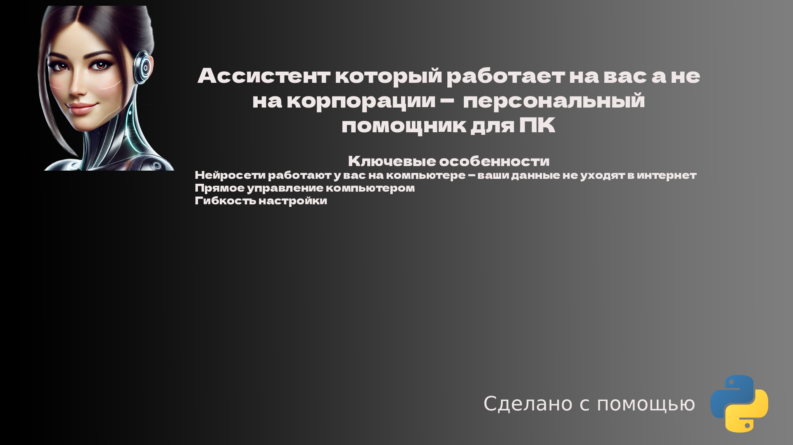
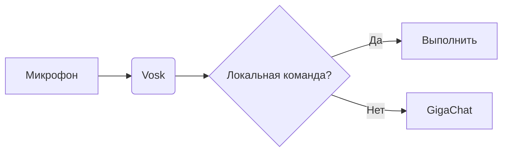

# 🚀 Астра — оффлайн-голосовой ассистент

<p align="center">
  
</p>

<p align="center">
  <b>Умный голосовой помощник для управления компьютером, работы с мультимедиа и общения с локальной языковой моделью.</b>
</p>

<p align="center">
  
</p>

<p align="center">
  <i>Интерфейс голосового ассистента Астра</i>
</p>

---

## 📖 О проекте

**Астра** — голосовой ассистент для Windows, который позволяет управлять компьютером с помощью голосовых команд, работать с мультимедиа, получать информацию из интернета и взаимодействовать с искусственным интеллектом.

Ассистент сочетает автоматизацию повседневных задач с локальной обработкой речи и возможностью использования языковых моделей.

## ✨ Ключевые преимущества

- 🎙️ **Голосовое управление** — взаимодействие с компьютером с помощью голосовых команд.
- 🔒 **Конфиденциальность** — локальное распознавание речи и возможность использовать локальную языковую модель.
- 🖥️ **Управление Windows** — выключение и перезагрузка компьютера, горячие клавиши и другие системные команды.
- 🎵 **Мультимедиа** — поиск и воспроизведение музыки и фильмов.
- 🌐 **Интернет-функции** — поиск информации, получение погоды и чтение новостей.
- 🧩 **Модульная архитектура** — возможность расширять функциональность и добавлять новые команды.

---

## 📌 Оглавление
- [Требования](#-требования)
- [Структура проекта](#-структура-проекта)
- [Архитектура системы](#-архитектура-системы)
- [Технологии](#-технологии)
- [Настройка ИИ-ответов](#-настройка-ии-ответов)
- [Примеры команд](#-примеры-команд)
- [Установка](#-установка)     


## Требования    
- Windows 10/11
- Python 3.8+  
- Микрофон  
- Интернет *(только для некоторых функций: погода, новости, поиск и онлайн-медиа)*
- Google Chrome

## Структура проекта
```text
Voice_Assistant/
├── src/                              # Основной код приложения
│   ├── __init__.py
│   ├── main.py                       # Точка входа
│   ├── core/                         # Ядро ассистента
│   │   ├── __init__.py
│   │   └── assistant_core.py
│   ├── speech/                       # Работа с речью
│   │   ├── __init__.py
│   │   ├── speech_module.py
│   │   └── tts_module.py
│   ├── audio/                        # Воспроизведение звуков
│   │   ├── __init__.py
│   │   └── sound_module.py
│   ├── system/                       # Управление ОС
│   │   ├── __init__.py
│   │   └── system_control.py
│   ├── interface/                    # Пользовательский интерфейс
│   │   ├── __init__.py
│   │   └── interface.py
│   ├── integrations/                 # Внешние интеграции
│   │   ├── __init__.py
│   │   └── chat_gpt.py
│   ├── network/                      # Сетевые операции
│   │   ├── __init__.py
│   │   └── network.py
│   ├── services/                     # Сервисы контента
│   │   ├── __init__.py
│   │   ├── film_service.py
│   │   ├── music_service.py
│   │   └── web_driver_manager.py
│   └── config/                       # Конфигурация приложения
│       ├── commands.json
│       └── settings.json
├── assets/                           # Ресурсы приложения
│   ├── sounds/
│   ├── vosk-model-small-ru-0.22/
│   ├── img/
│   └── main_applications/
├── logs/                             # Логи работы ассистента
│   └── assistant.log
├── run.py
├── pyproject.toml
├── .python-version
└── uv.lock
```
## Архитектура системы


## Технологии
| Модуль          | Описание                          |
|-----------------|-----------------------------------|
| `vosk`          | Оффлайн распознавание речи        |
| `sounddevice`   |Запись аудио с микрофона           |
| `pyttsx3`       | Синтез речи                       |
| `numpy`         | Работа с аудиоданными             |
| `RapidFuzz`     | Нечеткий поиск команд             |
| `lmstudio`      | Локальные LLM-модели для ответов  |
| `selenium`      | Автоматизация браузера для медиа  |
| `fake-useragent`| Генерация случайных User-Agent для веб-запросов|
| `webdriver-manager`| Управление драйверами для Selenium|
| `feedparser`   | Чтение новостей RSS-лент|
| `BeautifulSoup`| Очистка текста новостей от HTML-тегов|
| `requests`         |HTTP-запросы к API и веб-серверам|
| `pygame`        | Воспроизведение аудио             |
| `pywin32`       | Интеграция с Windows API          |
| `keyboard`      | Эмуляция нажатия клавиш           |
| `pyperclip`     | Работа с буфером обмена           |
| `customtkinter` | Современный GUI интерфейс         |

## Настройка ИИ-ответов

Ассистент использует локальную LLM-модель с кастомизированным system_prompt<br>
**Правила:**
- **Краткие, но информативные** (1-2 предложения)  
- **Дружелюбные и естественные**
- **Предложение поиска в интернете, если нужны точные данные (курс валют и т.д.)**
- **Блокировку вредоносных, опасных или неэтичных запросов**  
- **Без сложных терминов**  
- **Структурированные** для списков/инструкций  
 
  
## Примеры команд
```bash
"Астра, открой браузер"  
"Астра, какая погода?" → ассистент: "Укажите город" → пользователь называет город → ассистент сообщает погоду"  
"Астра, выключи компьютер"  
```
## Установка
1. Клонирование репозитория:
 ```
https://github.com/fetgrigory/Voice_Assistant.git
   ```
2. Создайте виртуальное окружение для изоляции зависимостей проекта. 
   Используйте команду:
   ```bash
   uv venv
   ```

3. Активируйте виртуальное окружение:
   - На Windows:
     ```bash
     .venv\Scripts\activate
     ```
   - На macOS и Linux:
     ```bash
     source .venv/bin/activate
     ```
4. Установка зависимостей:
   ```bash
      uv sync
     ```
5. Запустите ассистента командой:
   ```bash
   python run.py
   ```
